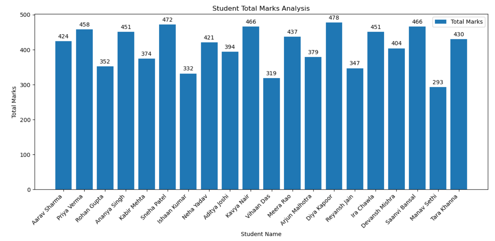
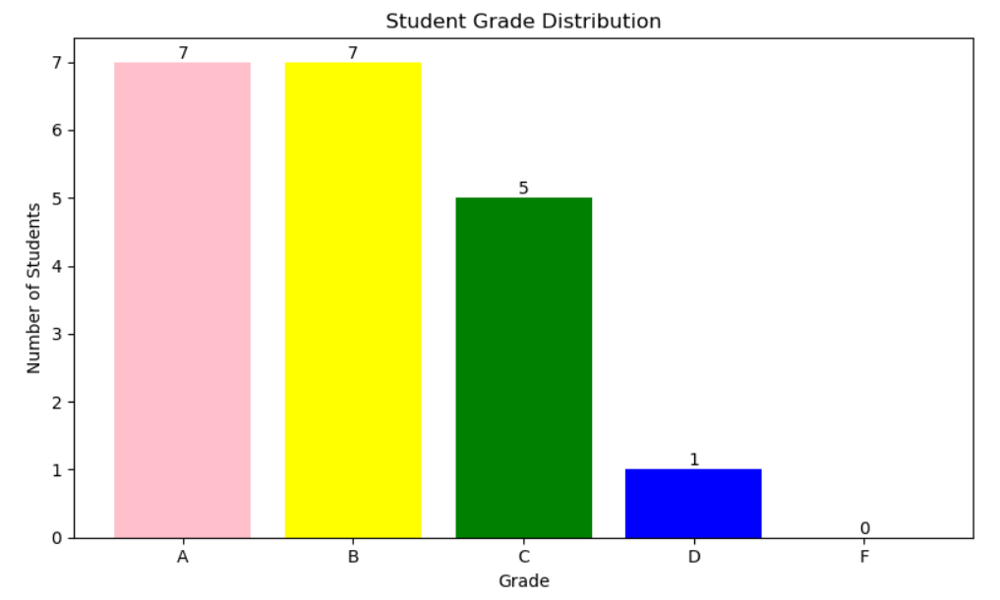
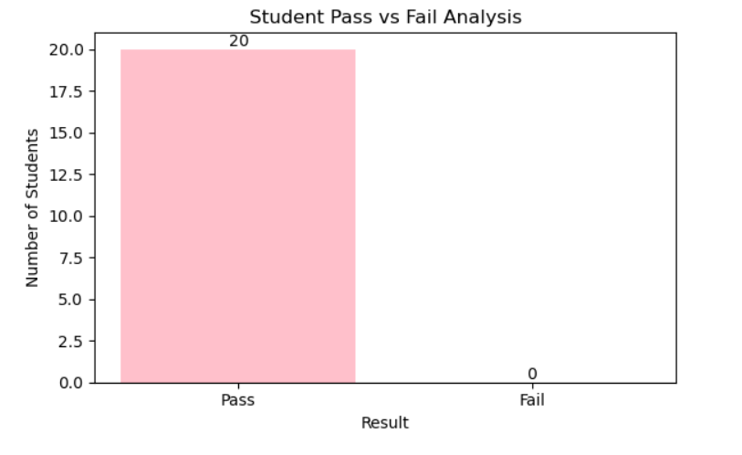
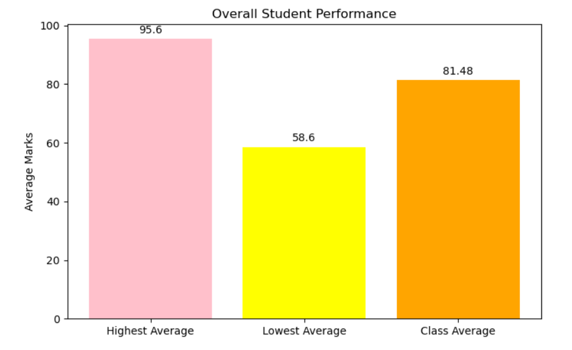
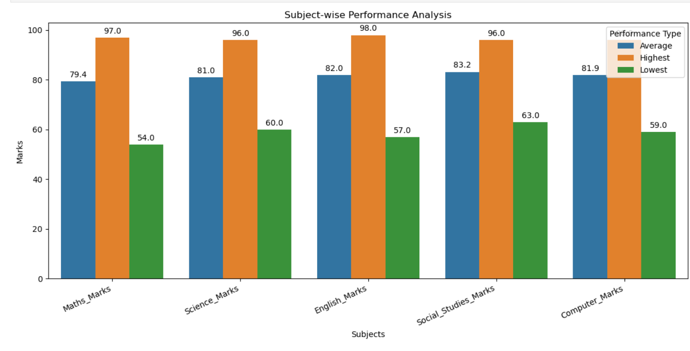
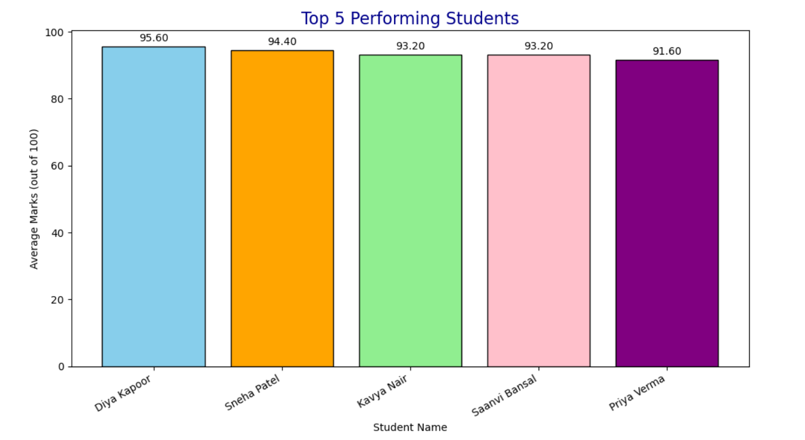

# Student Performance Analytics System

## 1. Project Title

**Project Title:** Student Performance Analytics System 

| Detail | Information |
|---|---|
| Student Name | KOMAL |
| Course | Python with AI – EWB Courses |


---

## 2. Objective

Schools and teachers handle large amounts of student marks, and calculating totals, averages, grades and results by hand is slow and error-prone. This project automates that work.

The system reads student records from a CSV file, processes them using Python, NumPy and Pandas, and produces clear results such as:

- Total and average marks of each student
- Grade of each student based on a defined grading rule
- Pass/Fail status of each student
- Highest, lowest and overall class average
- Subject-wise performance
- Top-performing students

---

## 3. Technologies Used

| Technology | Purpose |
|---|---|
| Python 3 | Main programming language (variables, loops, functions, conditions) |
| NumPy | Numerical calculations (`np.sum`, `np.mean`) |
| Pandas | Loading, organizing, sorting and analysing the data (DataFrame) |
| Matplotlib | Creating bar charts |
| Seaborn | Grouped bar chart for subject-wise analysis |
| Jupyter Notebook | Writing and running the code with its output |

---

## 4. Dataset Description

- **File:** `student_records_marks_attendance.csv`
- **Number of records:** 20 students
- **Number of columns:** 12
- **Missing values:** None (checked using `df.isnull().sum()`)

| Column | Description |
|---|---|
| Student_ID | Unique ID of the student (e.g., STU1001) |
| Student_Name | Name of the student |
| Gender | Male / Female |
| Class | Class of the student (6 to 10) |
| Section | Section of the student (A, B, C) |
| Date_of_Birth | Date of birth |
| Maths_Marks | Marks in Maths (out of 100) |
| Science_Marks | Marks in Science (out of 100) |
| English_Marks | Marks in English (out of 100) |
| Social_Studies_Marks | Marks in Social Studies (out of 100) |
| Computer_Marks | Marks in Computer (out of 100) |
| Attendance_Percentage | Attendance of the student in % |

**Columns created during processing:** `Total_Marks`, `Average_Marks`, `Grade`, `Result`

---

## 5. Implementation

### Step 1 – Importing Libraries
`pandas`, `numpy`, `matplotlib.pyplot` and `seaborn` were imported.

### Step 2 – Loading the Dataset
The CSV file was loaded into a Pandas DataFrame using `pd.read_csv()`, and the first 25 rows were displayed with `df.head(25)`.

### Step 3 – Checking Null Values
`df.isnull().sum()` confirmed that there are no missing values in any column.

### Step 4 – Total and Average Marks
The five subject columns were stored in a list (`Subjects`). NumPy was used to calculate the values row by row:

```python
df["Total_Marks"]   = np.sum(df[Subjects].to_numpy(), axis=1)
df["Average_Marks"] = np.mean(df[Subjects].to_numpy(), axis=1)
```

### Step 5 – Assigning Grades
A reusable function `calculate_grade(average)` assigns a grade using this rule:

| Average Marks | Grade |
|---|---|
| 90 and above | A |
| 75 to 89.99 | B |
| 60 to 74.99 | C |
| 35 to 59.99 | D |
| Below 35 | F |

The function is applied to the `Average_Marks` column using `.apply()`.

### Step 6 – Pass / Fail Result
A reusable function `calculate_result(marks)` returns **Pass** only if the student scored **35 or more in every subject**; otherwise **Fail**. It is applied row by row using `.apply(..., axis=1)`.

### Step 7 – Highest, Lowest and Overall Average
`max()`, `min()` and `mean()` were used on the `Average_Marks` column.

### Step 8 – Subject-wise Analysis
A `for` loop goes through each subject and prints its average, highest and lowest marks. The results are then collected into a new DataFrame and shown as a grouped bar chart.

### Step 9 – Top Performers
`sort_values(by="Average_Marks", ascending=False).head(5)` gives the top 5 students.

### Step 10 – Individual Student Report
A `for` loop with `df.iterrows()` prints the total marks, average, grade and result of each student.

### Step 11 – Visualisation
Bar charts were created for total marks, grade distribution, pass/fail count, overall performance, subject-wise performance and top 5 students.

---

## 6. Key Features

- Loads and organizes student data using a Pandas DataFrame
- Checks the dataset for missing values
- Uses NumPy for total and average calculations
- Reusable functions: `calculate_grade()` and `calculate_result()`
- Uses loops for subject-wise analysis and the student-wise report
- Assigns grades using a clearly defined grading rule
- Identifies Pass/Fail students using a clear condition (≥ 35 in every subject)
- Finds highest, lowest and overall class average
- Subject-wise average, highest and lowest marks
- Identifies the top 5 performing students
- Six charts to visualise the results

---

## 7. Output / Screenshots


### Total Marks of Each Student


### Grade Distribution


### Pass vs Fail


### Overall Student Performance


### Subject-wise Performance


### Top 5 Students


### Key Results

| Metric | Value |
|---|---|
| Highest Average | 95.6 (Diya Kapoor) |
| Lowest Average | 58.6 (Manav Sethi) |
| Overall Class Average | 81.48 |
| Students Passed | 20 out of 20 |
| Students Failed | 0 |

**Grade Distribution:** A – 7, B – 7, C – 5, D – 1, F – 0

**Subject-wise Averages:**

| Subject | Average | Highest | Lowest |
|---|---|---|---|
| Maths | 79.40 | 97 | 54 |
| Science | 80.95 | 96 | 60 |
| English | 81.95 | 98 | 57 |
| Social Studies | 83.20 | 96 | 63 |
| Computer | 81.90 | 96 | 59 |

**Top 5 Students:**

| Rank | Name | Average | Grade |
|---|---|---|---|
| 1 | Diya Kapoor | 95.6 | A |
| 2 | Sneha Patel | 94.4 | A |
| 3 | Kavya Nair | 93.2 | A |
| 3 | Saanvi Bansal | 93.2 | A |
| 5 | Priya Verma | 91.6 | A |

---

## 8. Final Outcome

The project successfully built a Student Performance Analytics System that turns raw student records into useful information. From the analysis:

- All 20 students passed, with no failures.
- The class average is **81.48**, which shows good overall performance.
- 14 out of 20 students (70%) scored Grade A or B.
- **Social Studies** is the best-performing subject (average 83.20), while **Maths** has the lowest average (79.40).
- **Diya Kapoor** is the top performer, and **Manav Sethi** has the lowest average and may need extra support.

The output is presented through printed tables and charts, so it can be understood without reading the code.

---

## 9. Challenges & Learning

| Challenge | How it was solved |
|---|---|
| Calculating totals and averages for every student at once | Used NumPy with `axis=1` to calculate across each row |
| Assigning grades and results for each row | Wrote reusable functions and used `.apply()` |
| Long student names overlapping on the chart | Rotated the x-axis labels using `plt.xticks(rotation=..., ha="right")` |
| Comparing average, highest and lowest marks per subject in one chart | Built a new DataFrame and used a Seaborn grouped bar chart with `hue` |
| Showing exact values on the bars | Used `plt.bar_label()` |

**What I learned:**
- How to load, clean-check and analyse data with Pandas
- How NumPy makes numerical calculations fast and simple
- How to write reusable functions and use loops effectively
- How to present data using Matplotlib and Seaborn charts
- How to organize a project and publish it on GitHub with documentation

---

## 10. GitHub Repository

🔗 **Repository Link:** `https://github.com/komalkushwaha0009/student-performance-analytics`

### Project Structure

```
student-performance-analytics/
│
├── Student_Performance_Analysis.ipynb      # Main project notebook
├── student_records_marks_attendance.csv    # Dataset
├── README.md                               # Project documentation
└── screenshot/                            # Output screenshots
```

### How to Run

1. Clone the repository
   ```bash
   git clone https://github.com/komalkushwaha0009/student-performance-analytics.git
   cd student-performance-analytics
   ```
2. Install the required libraries
   ```bash
   pip install pandas numpy matplotlib seaborn notebook
   ```
3. Open the notebook and run all cells
   ```bash
   jupyter notebook Student_Performance_Analysis.ipynb
   ```
